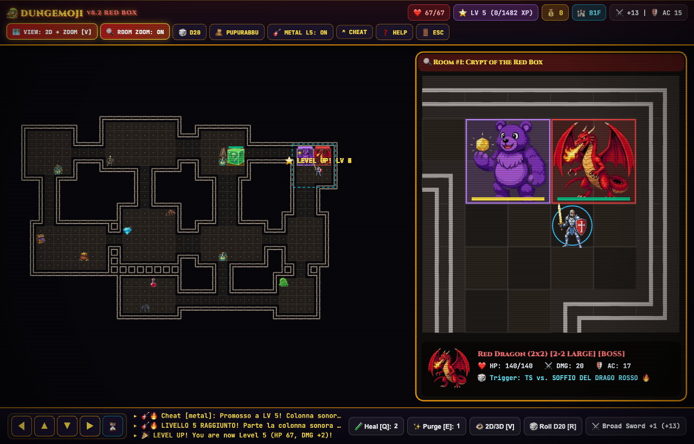
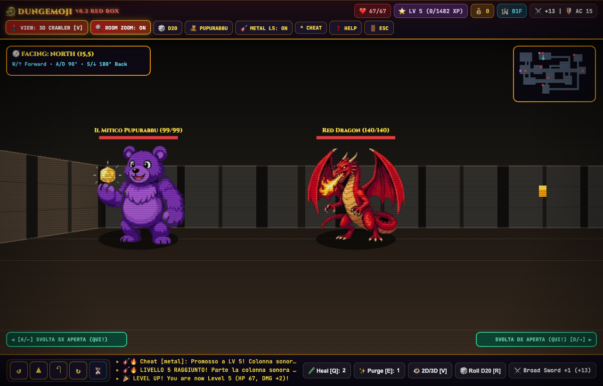

# 🐉 Dungemoji v8.3 — 1980s D&D Red Box Edition (NanoBanana 2D + Room Zoom + 3D Crawler)

Play live: **https://dungemoji.web.app/**

## ✨ Features in v8.3.0
- **3-Way Real-Time View Switcher (`[V]` key or HUD button)**:
  1. 🗺️ **2D Tactical Map + Room Zoom Inspector**: Explore procedural dungeons (`╔═╗║` seamless double-line stone grey & brown walls + torch Fog of War) with an automatic **Room Zoom** window showing magnified **NanoBanana 2D monsters**, HP bars, and D&D stats.
  2. 🕹️ **1980s Pixel 3D Dungeon Crawler (*Eye of the Beholder / Wizardry* Mode)**: First-person perspective stone grey & sandstone brown walls, exact DDA raycaster (`cast3DRay`), 180° in-place U-Turn (`S`/`↓`), live side-passage HUD indicators, depth-buffered NanoBanana monsters & treasures, and a top-right 2D radar minimap.
  3. 👾 **Classic 1980s Rogue Mode**: Pure retro ASCII box-drawing + Emoji aesthetic with CRT scanlines.
- **27 Embedded NanoBanana 2D Sprites (with `2×2` Large & Boss Footprints)**:
  - **Classic 13**: Giant Rat 🐀, Vampire Bat 🦇, Goblin 👺, Venom Spider 🕷️, Skeleton 💀, Dire Wolf 🐺, **Plague Zombie** 🧟, Orc Berserker 👹, Green Slime 🦠, Ghost Specter 👻, Ogre Brute (`2×2`) 🦍, Cave Troll (`2×2`) 🧌, **Red Dragon Boss (`2×2`)** 🐉.
  - **1980s D&D Legends**: **Beholder (`2×2`)** 👁️, **Chest Mimic** 📦, **Mind Flayer (Illithid)** 🦑, **Gelatinous Cube (`2×2`)** 🟩, **Owlbear (`2×2`)** 🦉, **Demogorgon (`2×2`)** 👑.
  - **Special Cameo**: **Il Mitico Pupurabbu (`2×2`)** 🧸💜 — a tall, gentle, all-purple bear-like friend inspired by *Blue* from *IF* (summon anytime with `[P]` or `^pupurabbu`!).
- **🎲 Simil-3D Icosahedron (D20) Saving Throws**:
  - Mathematical 3D 20-sided die with facet lighting and physics bounce, triggering on classic **1980s D&D BECMI Saving Throws** (*Save vs. Dragon Breath, Poison/Death Ray, Paralysis/Acid, Mind Blast Spells, and Pupurabbu's Hug Roll*).
- **🎸 Level 5 Medieval Epic Metal MP3 (Lyria 3.5) & 80s Dungeon Synth**:
  - Levels 1–4 feature a lightweight WebAudio 80s synth; reaching **Level 5 (`LV 5`) or Floor `B5F`** (or typing `^metal`) unleashes a full **Medieval Epic Metal MP3** (`audio/epic_metal_l5.mp3`)!
- **🎬 Veo 3.1 1980s Pixel-Art Death Cutscene (`audio/death_default.mp4`)**:
  - Designed via an Adversarial Swarm (`dnd-grognard-critic`, rated **9.4/10**, [GHI #3](https://github.com/palladius/genai-googlecloud-scripts/issues/3)): when the Paladin falls (or via `^die`), plays the 16-bit VGA pixel-art Veo 3.1 animation of the kneeling Paladin, the fallen torch, the red D20 landing on `1`, and the Two Mysterious Glowing Red Eyes in the Dark!

## 🚀 Local Run, Test & Deploy
- Run tests: `just test`
- Local preview: `just run` (`http://localhost:8088`)
- Deploy to Firebase: `just deploy`
