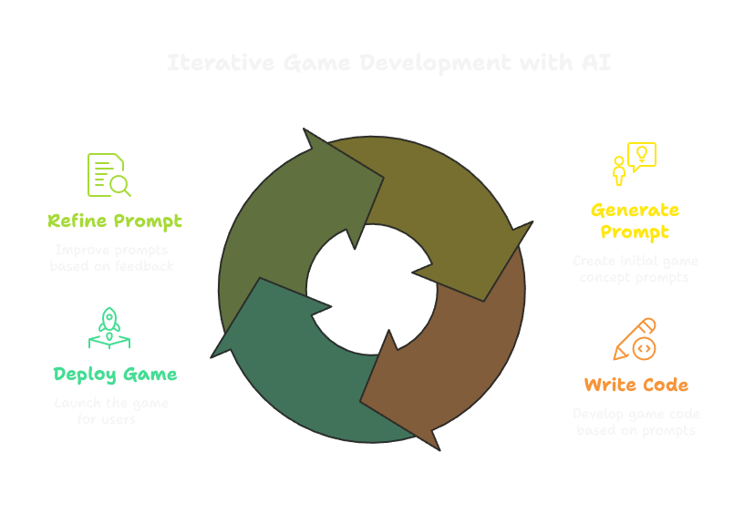
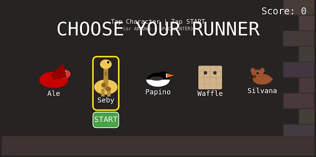
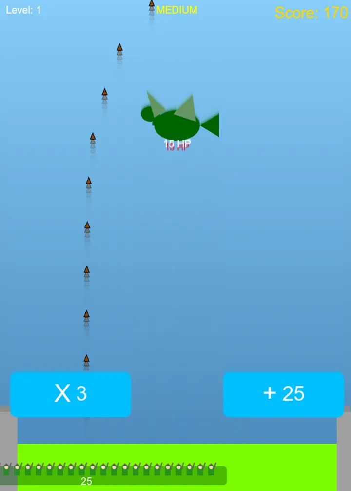
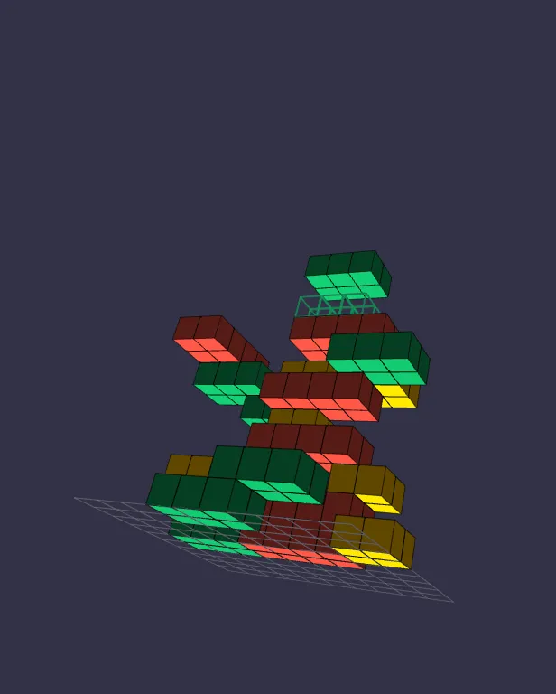
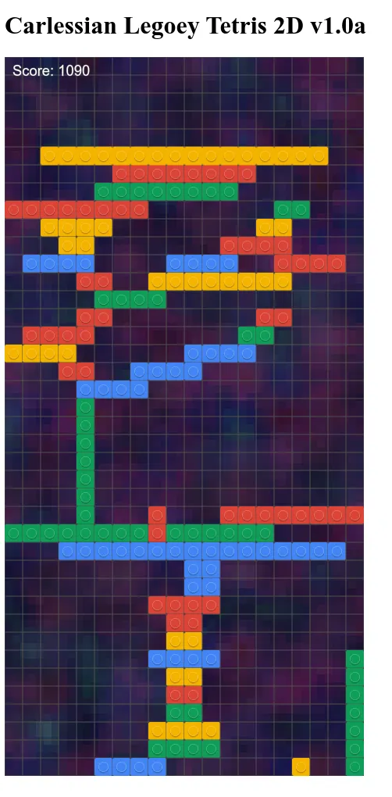
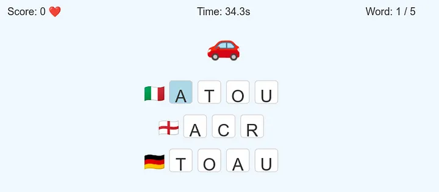

Article on Medium: https://medium.com/@palladiusbonton/wip-code-3d-kid-games-with-gemini-2-5-d580d6b9802b

Games represented here:

## Riccardo's Gemini-Powered Games

| Game Title                     | App URL                                       | Notes                                         |
| ------------------------------ | --------------------------------------------- | --------------------------------------------- |
| Dungeon Runner                 | [https://incandescent-inferno-1052.web.app/](https://incandescent-inferno-1052.web.app/) | An endless runner featuring family members. Sounds…*unique*. |
| Smurfs & Dragons (Math Shooter) | [https://smurfs-and-dragons.web.app/](https://smurfs-and-dragons.web.app/)       | Math practice with a Smurf/Dragon theme! Now that's what I call Edutainment (tm)! |
| 3D Googley Lego Tetris        | [https://gugley-3d-tetris.web.app/](https://gugley-3d-tetris.web.app/)            | Tetris with Google-coloured Lego in 3D. A spectacular creation, apparently. |
| 2D Legoey Tetris              | [https://legoey-2d-carlessian-tetris.web.app/](https://legoey-2d-carlessian-tetris.web.app/)      | The 2D version, for those of us who find 3D *too* stimulating. |
| Multilingual Anagrams         | [https://zurigram.web.app](https://zurigram.web.app)              | Anagram game in multiple languages! Kate *must* see this! |
| (Paolo's game, mentioned)         | [https://teal-georgianne-19.tiiny.site/](https://teal-georgianne-19.tiiny.site/)              | App by Riccardo's friend, Paolo, with the addition of Dutch and Lithuanian |
| Dungemoji v8.2 (1980s D&D Red Box) | [https://dungemoji.web.app/](https://dungemoji.web.app/) | Created for Alessandro as a reminiscence of an 80's game on my dad's 8086 Amstrad — now with 2D Room Zoom, 3D Eye of the Beholder Crawler, 27 NanoBanana sprites, 2x2 IF Pupurabbu & 3D D20 Saving Throws! |

## Firebase Feedback Loop

Do this only once in your computer:
1. Install firebase: `npm [-g] install firebase`. Use -g if you can, my work computer won't let me.
2. Make sure `firebase` is in your path (could be already, or coyuld be in `node_modules/.bin/` for instance).

Do this for every game/app/folder you create@:

1. First time: `firebase init`
2. Choose `firebase hosting`
3. Take inspiration from my `justfile` (because `Makefile` is so 2010s!)

## 1: Dungeon Runner

*   **Code:** [01-dungeon-runner](01-dungeon-runner/)
*   **App:** [https://incandescent-inferno-1052.web.app/](https://incandescent-inferno-1052.web.app/)

A Mario Bros clone featuring Riccardo's family (and the nanny!) as playable characters. They each have a totem "animal". Apparently, the game is so engaging that the kids preferred shooting walls to jumping. 🤦‍♂️ 💥🧱

## 2: Smurfs&Dragons — a math shooter

*   **Code:** [02-smurfs-and-dragons]([02-smurfs-and-dragons/)
*   **App:** [https://smurfs-and-dragons.web.app/](https://smurfs-and-dragons.web.app/)

Vertical shoot'em'up where the player army chooses between math operations such as "x3" or "+25" (blue, good), and "-10" or "/2" (red, bad). The player has to defeat dragons and smurfs, who represent the enemies.
The goal is to make math fun for 5 and 7 year olds, by making them solve problems like figuring out if it's better to get "+10" or "*2" when you have 8 soldiers.🧠➕✖️🐉🧝

## 3: 3D Googley Lego Tetris

*   **Code:** [03-googley-lego-tetris-3d](03-googley-lego-tetris-3d/)
*   **App:** [https://gugley-3d-tetris.web.app/](https://gugley-3d-tetris.web.app/)

A 3D Tetris clone with Lego pieces in Google's colors! The board is a whopping 16x16x100. Fill a 16x16x1 slice and *poof*, Tetris magic happens! Controls are a bit tricky, using EasyCam and HTML. Sounds like a graphical tour-de-force (that Riccardo didn't write). 🧱🌈✨

## 4: 2D Legoey Tetris

*   **Code:** [04-lego-tetris-2d](04-lego-tetris-2d/)
*   **App:** [https://legoey-2d-carlessian-tetris.web.app/](https://legoey-2d-carlessian-tetris.web.app/)

The 3D Tetris, but flattened! Now with a 20x80 board. Still with Googley Lego bricks.  The fun part? If you stack three thin Lego bricks in a row, *kaboom*! The whole row explodes! 💥🧱🔥 Too bad Riccardo couldn't get Gemini to render the Legos sideways, though. 😔

## 5: Multilingual Anagrams #Omakase

*   **Code:** [05-multilanguage-word-game](05-multilanguage-word-game/)
*   **App:** [https://zurigram.web.app](https://zurigram.web.app)
*

An anagram game for multilingual kids! Supports English, Italian, German and French. The game shows an emoji and the jumbled letters of the word in different languages. Match "apple" in 4 languages for a win! 🍎🇩🇪🇬🇧🇮🇹🇫🇷 A 6:30 AM coding breakthrough! ☕️

## 8: Dungemoji v8.2 — 1980s D&D Red Box Edition

*   **Code:** [08-dungemoji](08-dungemoji/)
*   **App:** [https://dungemoji.web.app/](https://dungemoji.web.app/)

Born for Alessandro as a tribute to classic 1980s ASCII Roguelikes on an 8086 Amstrad, now evolved into a **1980s D&D Red Box Edition** featuring real-time `[V]` switching between **2D Tactical Map + Room Zoom Inspector**, **First-Person 3D Eye of the Beholder Dungeon Crawler**, and **Classic ASCII Rogue**, plus **27 NanoBanana sprites** (including **2×2 Il Mitico Pupurabbu** 🐻💜 and **2×2 Red Dragon** 🐉), **3D D20 Saving Throws**, **Level 5 Epic Metal MP3**, and **1980s Pixel-Art / Veo Death Cutscenes**! 🎲⚔️

